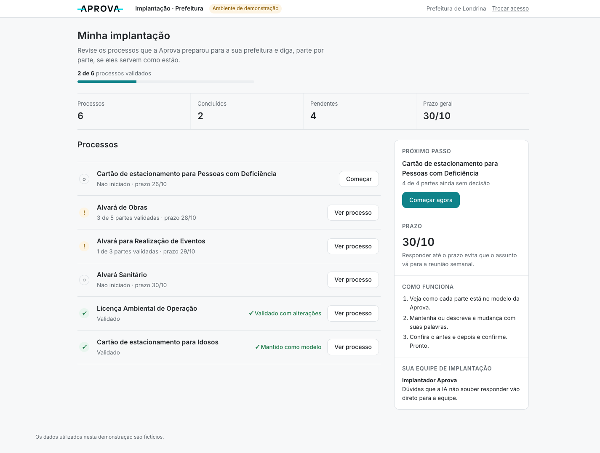
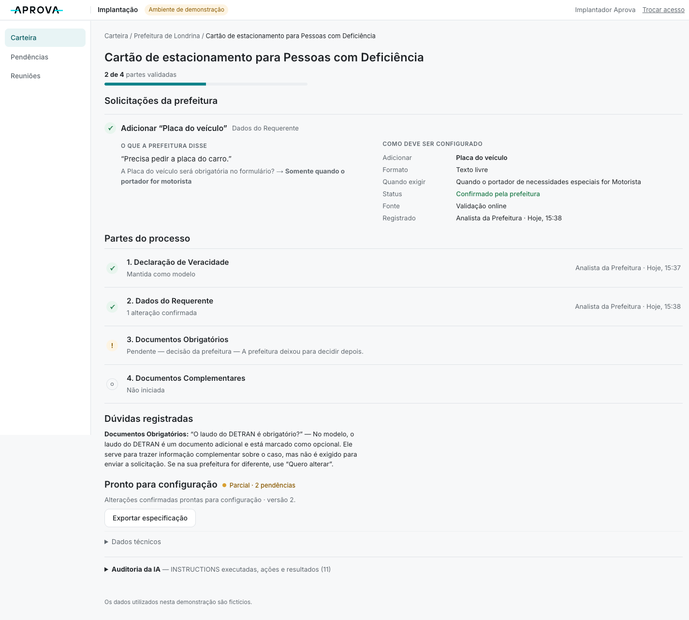

# Aprova Valida

**Validação inteligente da implantação**

> Camada de validação guiada que ajuda prefeituras a revisar processos-modelo em linguagem natural e entrega decisões estruturadas para o time de implantação da Aprova.

**Demo:** https://aprova-valida.vercel.app

**Hackathon Aprova 2026 — Desafio Implantação**

Time Pila
Pietro Catafesta Montezano
Luiz Henrique Santetti


---

## Problema

A Aprova implanta a partir de **processos-modelo**. Cada nova prefeitura precisa validar quais partes permanecem, quais mudam e quais regras locais existem.

Hoje esse trabalho passa por formulários, tickets, respostas assíncronas, reuniões e interpretação manual das respostas. Na prática:

- o cliente não responde, ou responde incompleto;
- responde sem linguagem técnica (“precisa pedir a placa do carro”);
- cada resposta gera novas perguntas;
- pendências acumulam de uma semana para outra;
- a reunião vira descoberta em vez de validação;
- a implantação perde escala.

## Solução

Uma camada de validação e decisão **entre o template e a configuração**.

```text
Processo-modelo
      ↓
Prefeitura valida parte por parte
      ↓
Manter | Alterar | Dúvida
      ↓
IA interpreta / explica
      ↓
Código valida lacunas
      ↓
Pergunta de complemento
      ↓
Antes / Depois
      ↓
Confirmação humana
      ↓
Implantação recebe handoff estruturado
      ↓
Pendências restantes
      ↓
Reunião com copiloto
```

Não substitui o formulário da Aprova, a clonagem de processos, o onboarding, os agents configuradores nem os sistemas atuais.

### Experiência da prefeitura

- lista dos processos com progresso e prazo;
- o sistema abre na próxima parte que precisa de decisão;
- cada parte explica, em linguagem simples, o que está sendo decidido e como funciona no modelo;
- três ações: **Manter como está · Quero alterar · Tenho uma dúvida**;
- ao alterar, a prefeitura escreve como fala; a IA interpreta e pergunta só o que falta;
- **antes / depois** legível e confirmação explícita.

### Experiência da implantação

- carteira de clientes com progresso, prazos e situação;
- pendências de todos os clientes e reuniões a fazer;
- respostas da prefeitura em tempo real na página do cliente;
- handoff legível por solicitação:

```text
O que a prefeitura disse   →   Como deve ser configurado   →   Status
“Precisa pedir a placa”        Adicionar: Placa do veículo     Confirmado pela prefeitura
                               Formato: Texto
                               Quando exigir: portador motorista
```

- dados técnicos e **Auditoria da IA** recolhidos, para quem precisa.

### Copiloto de reunião

A reunião tem três áreas: **Pauta · Transcrição · Copiloto**.

O agente acompanha os processos pendentes do cliente e cada novo trecho falado. Ele pode identificar uma decisão, propor a interpretação, associá-la ao processo certo e gerar o resumo da reunião.

Ele **não pode** confirmar automaticamente, inventar decisão, tratar silêncio como decisão nem usar contexto oculto como evidência. Toda decisão é confirmada pelo implantador.


---

## Arquitetura agêntica

A IA não é um chat isolado. Ela atua num ciclo com **contexto, estado, instruções, ações, validação, retorno do usuário, reavaliação, escalonamento e confirmação humana**.

| Capacidade | Instrução | O que faz |
|---|---|---|
| Orquestrador | `00` | Princípios globais em toda chamada: não decidir pela prefeitura, silêncio não é aprovação, template não é verdade local, não inventar regra nem interpretar legislação, lacunas definidas pelo código, só fala real é evidência |
| Interpretar alteração | `01` | “Precisa pedir a placa do carro.” → proposta *Adicionar campo “Placa do veículo”*, sem inventar propriedades |
| Formular complemento | `02` | O código aponta “faltou obrigatoriedade”; o agente pergunta “O preenchimento da placa será obrigatório?” |
| Acompanhar reunião | `03` | Recebe pauta, pendências, processos e transcrição; identifica possíveis decisões; nunca confirma |
| Explicar dúvida | `04` | Explica o template com o contexto disponível; se não houver, escala para a implantação |

As instruções ficam em [`/INSTRUCTIONS`](INSTRUCTIONS/README.md) e são **lidas em runtime**: `src/ai/llm.ts` monta o prompt de sistema como `00 + instrução da capacidade`, e `src/ai/agent.ts` tem uma função por capacidade. Cada execução aparece na Auditoria da IA.

### IA x regras determinísticas

A IA é usada onde há **linguagem e contexto**. O resto é código.

| IA | Código determinístico |
|---|---|
| interpretar pedido em linguagem natural | máquina de estados |
| transformar intenção em proposta | schema e validação da resposta estruturada |
| formular perguntas | verificar propriedades obrigatórias |
| explicar dúvidas | diff antes / depois |
| interpretar a transcrição | impedir confirmação automática |
| identificar possíveis decisões | controlar status e gerar a especificação |
| gerar o resumo da reunião | persistir a sessão demo |

Essa divisão reduz alucinação, decisão indevida, regra inventada e falso progresso.

### Saída estruturada

O modelo nunca devolve texto livre para alterar estado:

```text
LLM → JSON → Zod (src/core/schema.ts) → normalização → validador → estado
```

### Human-in-the-loop

- a IA nunca confirma em nome da prefeitura nem do implantador;
- silêncio não é aprovação;
- a reunião gera sugestões; o clique humano confirma;
- legislação e regras complexas são escaladas para a implantação.

### Fallback offline

`src/ai/offline.ts` executa regras simples quando não há chave, a API falha ou o modelo responde fora do formato. Fica marcado como **fallback offline** na interface e na auditoria — não é IA.

---

## Captura e transcrição da reunião

A reunião usa APIs nativas do navegador.

- **Captura:** `navigator.mediaDevices.getUserMedia()` para o microfone e `navigator.mediaDevices.getDisplayMedia()` para o áudio de uma aba (Meet, Teams, Zoom web).
- **Gravação:** `MediaRecorder` gera trechos curtos de áudio.
- **Detecção de fala:** `AudioContext` + `AnalyserNode` (Web Audio API) calculam o nível RMS. Uma pausa curta não corta a fala; cerca de 1,4 s de silêncio depois de falar fecha o trecho; há um limite máximo por trecho; o último trecho é preservado ao parar.

### Speech-to-text

O trecho vai para `POST /api/transcribe`. No servidor o áudio é recebido, convertido em arquivo **em memória** e enviado à OpenAI (`gpt-4o-mini-transcribe`, com fallback para `whisper-1`, idioma `pt`). O áudio não é armazenado.

### Vocabulário de domínio

Um contexto oculto com termos como ART, DETRAN, laudo e alvará melhora o reconhecimento. Esse contexto não aparece para o usuário, não entra na transcrição e não pode gerar decisão. Filtros descartam eco do prompt, ruído, texto implausível e transcrições vazias.

### Pipeline da reunião

```text
Áudio
  ↓
Browser
  ↓
MediaRecorder
  ↓
Detecção de pausa
  ↓
Trecho
  ↓
/api/transcribe
  ↓
gpt-4o-mini-transcribe
  ↓
Texto falado
  ↓
Agente de reunião
  ↓
GPT-5-mini + INSTRUCTION 03
  ↓
Possível decisão
  ↓
Confirmação humana
  ↓
Estado atualizado
```

## Modelo de linguagem

O agente usa **GPT-5-mini**, sempre no servidor. Configuração por `OPENAI_MODEL` (padrão `gpt-5-mini`) e `OPENAI_REASONING_EFFORT` (padrão `low`, para reduzir a latência da demo sem remover nenhuma validação).

---

## Tecnologias

| Tecnologia | Papel |
|---|---|
| **Next.js 15** | aplicação web e rotas de API server-side |
| **React** | interface das áreas Prefeitura, Implantação e Reunião |
| **TypeScript** | tipagem do domínio, do agente e das APIs |
| **OpenAI API** | agente (GPT-5-mini) e transcrição (`gpt-4o-mini-transcribe` / `whisper-1`) |
| **Zod** | validação de toda saída estruturada do modelo |
| **Vitest** | testes do núcleo determinístico |
| **Vercel** | hospedagem e execução das APIs |
| **Web Audio API** | nível de áudio e detecção de pausa |
| **MediaRecorder API** | gravação dos trechos de fala |
| **localStorage** | persistência da sessão demo no navegador |

## Arquitetura

```text
Browser
│
├── Prefeitura
├── Implantação
└── Reunião
│
├── localStorage (sessão demo)
│
└── APIs Next.js (stateless)
     │
     ├── /api/session      ações sobre a sessão
     └── /api/transcribe   fala → texto
             │
             └── OpenAI
```

| Pasta | Conteúdo |
|---|---|
| `src/core/` | domínio determinístico: template, validador, estados, diff, especificação, schemas |
| `src/ai/` | agente, chamada ao modelo, fallback offline |
| `src/server/` | serviço stateless: recebe (sessão, ação) e devolve a nova sessão |
| `src/demo/` | dados fictícios da carteira |
| `INSTRUCTIONS/` | comportamento do agente |

### Persistência

No protótipo, a sessão fica no `localStorage`: cada navegador tem a sua, com reload e troca entre Prefeitura e Implantação sem perder o estado. Uma versão de produção exigiria autenticação, banco, persistência compartilhada, controle de acesso e múltiplos usuários.

### Vercel

Publicado em https://aprova-valida.vercel.app. As APIs rodam no servidor, e as variáveis `OPENAI_API_KEY`, `OPENAI_MODEL`, `OPENAI_REASONING_EFFORT` e `OPENAI_TRANSCRIBE_MODEL` ficam configuradas na Vercel. Nenhum segredo vai para o navegador nem para o Git.

---

## Como rodar localmente

```bash
git clone https://github.com/PietroPCM/Aprova-Time-Pila.git
cd Aprova-Time-Pila
npm install
cp .env.example .env.local   # preencha OPENAI_API_KEY
```

```env
OPENAI_API_KEY=
OPENAI_MODEL=gpt-5-mini
OPENAI_REASONING_EFFORT=low
OPENAI_TRANSCRIBE_MODEL=gpt-4o-mini-transcribe
```

```bash
npm run dev                  # desenvolvimento
npm run build && npm start   # produção local
npm test                     # testes
```

O microfone exige HTTPS fora de `localhost`.

## Limitações do protótipo

- dados fictícios;
- sem integração com os sistemas internos da Aprova;
- persistência local ao navegador, sem multiusuário;
- apenas o cenário principal (Prefeitura de Londrina · Cartão de estacionamento PcD) é totalmente interativo;
- o formato da especificação é provisório;
- a latência depende da API.

## Telas

| | |
|---|---|
|  |  |
|  |  |
|  |  |

---

Desenvolvimento apoiado por ferramentas de programação assistida por IA durante o hackathon.
