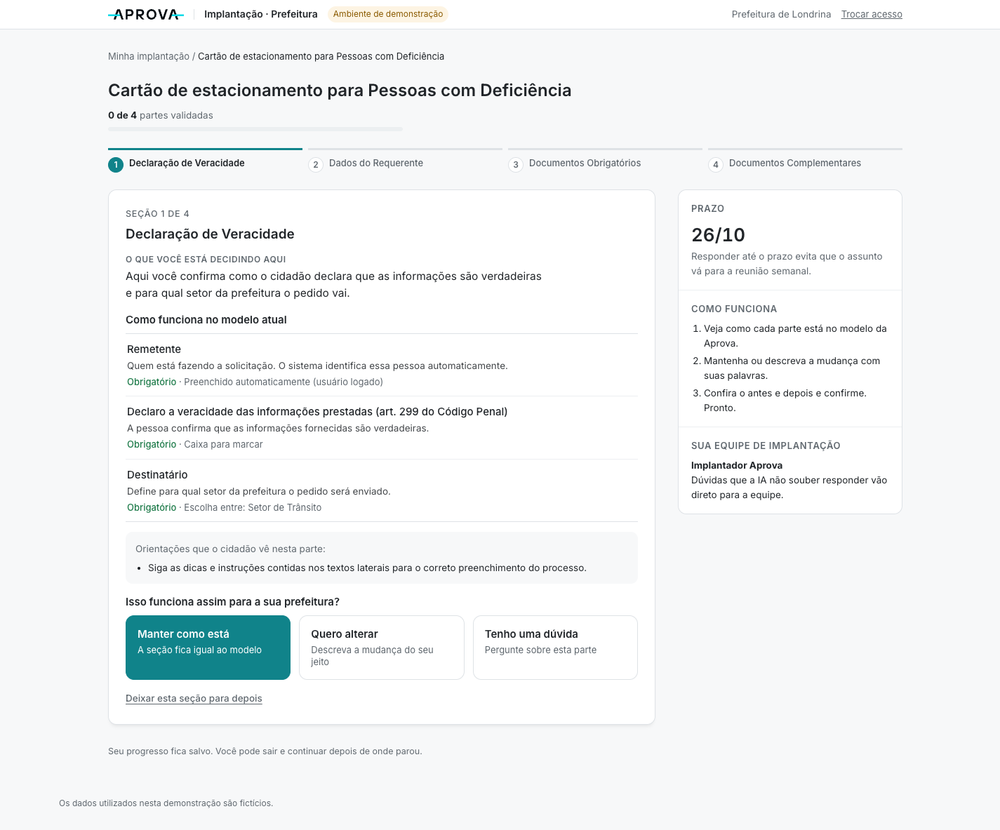
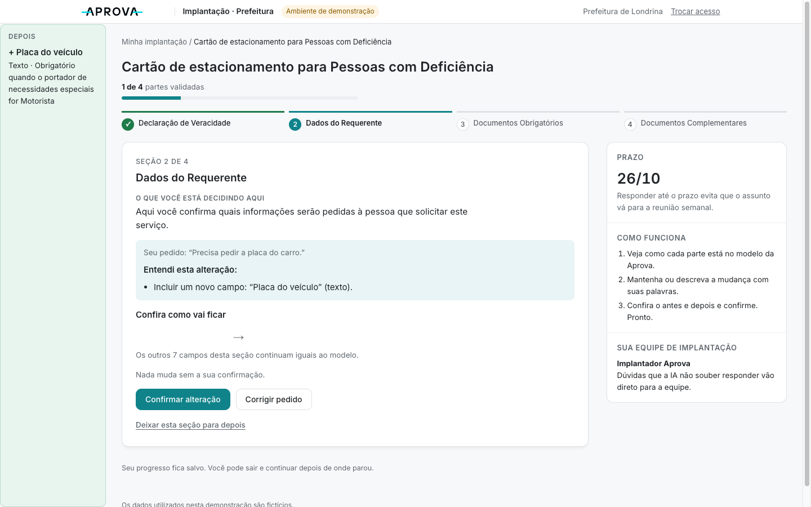
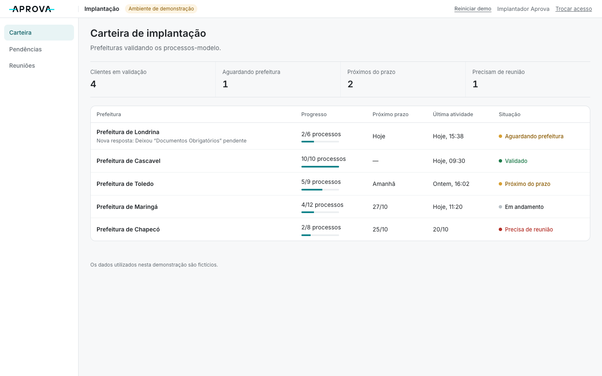
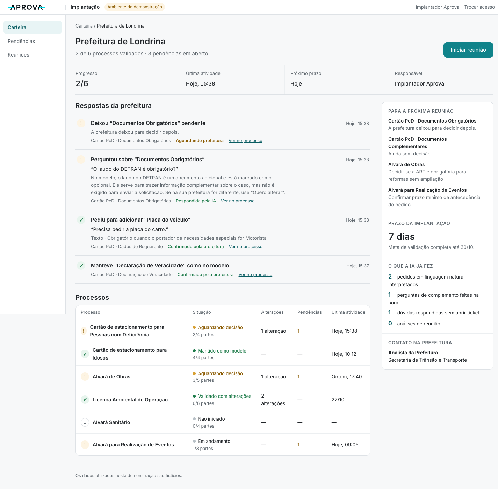
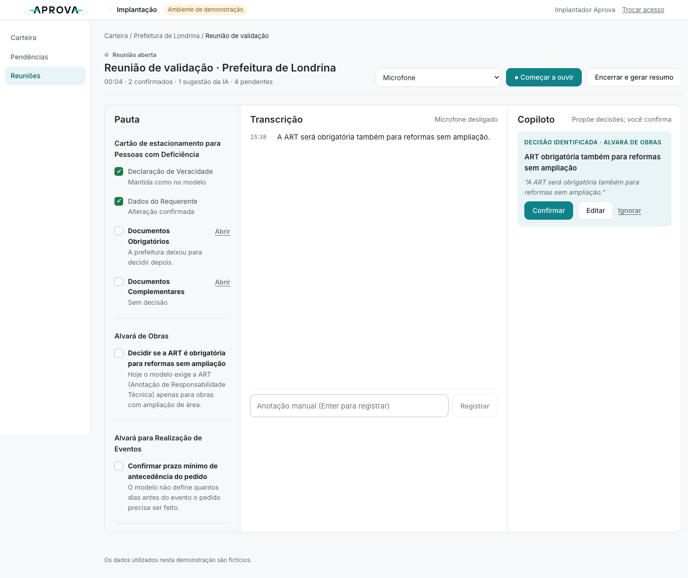

# Aprova Valida

**Validação inteligente da implantação.** Hackathon Aprova 2026 · desafio **Implantação** · Time Pila (Pietro Catafesta Montezano · Luiz Henrique Santetti)

> *“Como coletar e validar a regra de negócio de ~100 processos sem depender de reunião?”*

**Demo publicada:** __VERCEL_URL__



---

## O problema

A Aprova parte de **processos-modelo** (templates da cidade modelo). Cada prefeitura precisa validar o que serve e o que muda localmente. Hoje isso depende de:

- link do formulário + respostas assíncronas;
- tickets;
- reuniões semanais;
- **tradução manual** da linguagem da prefeitura (“precisa pedir a placa do carro”) para configuração (tipo, obrigatoriedade, condição…).

Quando a informação não volta — ou volta incompleta — as pendências acumulam, surgem novas perguntas, a reunião vira **descoberta** em vez de validação e a implantação perde escala.

## A solução

Uma **camada de decisão** entre o **template existente** e a **configuração** (os agents configuradores que a Aprova já possui). Não recria formulário, clonagem, onboarding nem configurador.

| Quem | O que faz |
|---|---|
| **Prefeitura** | Valida cada parte do processo com três decisões: **Manter como está · Quero alterar · Tenho uma dúvida**. Cada parte explica, em linguagem simples, o que está sendo decidido. |
| **IA** | Interpreta o pedido em linguagem natural, formula a pergunta de complemento que falta, explica dúvidas usando só o template, acompanha a reunião e identifica decisões. |
| **Código (determinístico)** | Valida o schema e decide **o que falta** (ex.: obrigatoriedade), controla os estados, monta o antes → depois e a especificação. **Só um clique humano confirma.** |
| **Implantação** | Recebe o que a prefeitura pediu já traduzido para configuração (“O que a prefeitura disse → Como deve ser configurado → Status”), acompanha a carteira, pendências e reuniões. |
| **Reunião** | Sala ao vivo: **Pauta · Transcrição (microfone real) · Copiloto**. O copiloto analisa a pauta inteira (inclusive outros processos do cliente), sugere decisões, o implantador confirma/edita/ignora e o sistema gera o resumo. |

## O que é agêntico

O agente não é um chat: ele **age dentro de um ciclo com estado**, sempre limitado por regras explícitas.

1. **Interpreta** um pedido livre e o transforma em operação estruturada (adicionar, alterar ou remover campo).
2. O **validador** aponta a lacuna; o agente **decide qual pergunta fazer**, em linguagem leiga.
3. Reinterpreta a resposta até a proposta ficar completa → mostra **antes/depois** → aguarda confirmação humana.
4. Na dúvida, **decide** se o template responde ou se escala para a implantação.
5. Na reunião, **escuta** (transcrição real), **identifica** decisões de qualquer item da pauta, **deduplica** e **resume**.

Princípios: a IA nunca decide pela prefeitura · silêncio nunca é aprovação · template é ponto de partida · quem decide o que falta é o código · só fala real é evidência de decisão.

## INSTRUCTIONS (requisito do hackathon)

As instruções em [`/INSTRUCTIONS`](INSTRUCTIONS/README.md) são **carregadas em runtime** como prompt de sistema (`src/ai/llm.ts`). Cada execução fica registrada na **Auditoria da IA** (tela do processo, área Implantação): instrução · ação · resultado · horário · se foi IA, código ou fallback.

| Instrução | Quando é chamada | O que faz |
|---|---|---|
| `00-orquestrador-validacao.md` | Prefixo de **toda** chamada | Princípios e limites (não decidir, não inventar, só JSON) |
| `01-interpretar-alteracao.md` | “Quero alterar” e cada resposta de complemento | Linguagem natural → proposta estruturada |
| `02-formular-complemento.md` | Quando o validador aponta lacunas | Pergunta curta, fechada e leiga |
| `03-acompanhar-reuniao.md` | Reunião: a cada trecho novo de fala/nota, e no resumo | Decisões da pauta inteira (nunca confirma) + resumo executivo |
| `04-explicar-duvida.md` | “Tenho uma dúvida” | Explica usando só o template; sem contexto → implantação |

## Arquitetura

```
Next.js 15 (App Router) · TypeScript · Zod · OpenAI (server-side) · Vitest
src/core/      domínio determinístico: template, validador, máquina de estados, diff, especificação
src/ai/        agente: carrega INSTRUCTIONS, chama OpenAI, valida saída; fallback offline rotulado
src/server/    service stateless: recebe (sessão, ação) → devolve nova sessão
src/app/api/   /api/session (ações) · /api/transcribe (fala → texto, sem armazenar áudio)
src/demo/      dados fictícios da carteira (clientes, processos, pauta)
INSTRUCTIONS/  instruções do agente (julgadas)
```

- **API stateless**: o servidor não guarda estado nem escreve em disco; funciona em Vercel/serverless.
- **Persistência da demo no navegador** (`localStorage`). Para o protótipo do hackathon, o estado da demonstração é persistido localmente no navegador. Uma implementação de produção utilizaria persistência compartilhada e identidade da prefeitura/implantador.
- `OPENAI_API_KEY` só no servidor. Erros da API nunca expõem a requisição nem a chave.

## Rodar localmente

```bash
npm install
# crie .env.local (não versionado):
#   OPENAI_API_KEY=...
#   OPENAI_MODEL=gpt-5-mini          (opcional)
npm run build && npm start          # produção (use para apresentar)
# ou: npm run dev                   # desenvolvimento
npm test                            # testes do núcleo determinístico
```

Abra `http://localhost:3000` → **Prefeitura** ou **Implantação**. O microfone exige HTTPS fora de `localhost`.

## Roteiro da demo (≈3 min)

1. **Prefeitura → Minha implantação → Começar agora.** A parte já explica o que se decide.
2. *Declaração* → **Manter como está** → confirmar.
3. *Dados do Requerente* → **Quero alterar**: “Precisa pedir a placa do carro.” → a IA pergunta a obrigatoriedade → “Só quando o portador for motorista” → **antes/depois** → **Confirmar alteração**.
4. *Documentos* → **Tenho uma dúvida** → resposta contextual → **Deixar para depois**.
5. **Implantação → Carteira → Prefeitura de Londrina**: “Respostas da prefeitura” → abrir o processo → handoff humano.
6. **Iniciar reunião** → **● Começar a ouvir** e falar: “A ART será obrigatória também para reformas sem ampliação.” · “O prazo mínimo de antecedência será de quatro dias.” · “O laudo do DETRAN vai ser obrigatório só quando o portador for motorista.” → **Confirmar** cada decisão.
7. **Encerrar e gerar resumo** → **Voltar ao cliente**: decisões refletidas. *Reiniciar demo* na Carteira volta ao início.

## Limitações honestas

- Dados **fictícios**; processo principal inspirado na estrutura observada no ambiente modelo.
- **Sem integração real** com a Aprova ou com os agents configuradores; formato da especificação é **provisório**.
- Persistência **local ao navegador** (sem multiusuário real, sem identidade).
- Apenas um processo (Cartão PcD) e uma prefeitura (Londrina) conectados ao fluxo completo; os demais são somente leitura.
- Latência da IA ~3–10 s por passo; sem a chave, um fallback offline rotulado mantém a demo.

## Screenshots

| | |
|---|---|
|  |  |
|  |  |
|  |  |

Todas as telas: [`docs/prints/`](docs/prints/).
